# 📖 第二章：核心概念扫盲 —— 从软件基建到 AI Agent 的基础概念

第一章建立了演进视角，本章进一步说明软件与 Agent 中常见的技术概念，以及这些概念如何衔接。

内容从计算机、网络、前后端和 Git 开始，逐步进入 Transformer、Agent 闭环、上下文工程、MCP、RAG、多智能体、微调量化、Harness/Loop 工程和主流开发框架。每节都结合一个具体场景说明“它解决什么问题、边界在哪里、怎样验证”，便于按需查阅。

---

## 🧭 第二章全景知识图谱

<!-- 图表源文件：img/diagrams/overview-diagram-01.mmd；视觉风格：学术彩色版（蓝、青、金、紫、珊瑚） -->

  

---

## 📑 章节目录导航

点击下方链接逐一阅读各小节的解释、示例与官方链接：

1. **[2.1 软件架构基础：计算机、网络、前端、后端、数据库、中间件、微服务、同步与异步](./01_软件架构基础.md)**
   - 先补底层：电脑与操作系统怎样运行、IP/端口/服务器/接口是什么，以及一次网页请求的基本路径；再用饭店前厅与后厨的比喻理解软件各层如何协作。

2. **[2.2 Git 与 GitHub 入门：版本记录、代码托管与代理配置](./02_Git与GitHub极速入门.md)**
   - 什么是 Git 存盘点？什么是 GitHub 社交广场？国内如何配置代理流畅拉取代码？

3. **[2.3 大模型本质与工作原理：超级文字接龙、高维压缩与 Transformer](./03_大模型本质与Transformer.md)**
   - 大模型到底是怎么学会说话的？它的本质是什么？Transformer 注意力机制在解决什么？

4. **[2.4 Agent 机制与运行原理：给大模型装上眼睛、双手与规划大脑](./04_Agent机制与运行原理.md)**
   - 为什么普通聊天模型不是 Agent？用 ReAct（思考-行动-观察）闭环说明模型、工具与反馈的关系。

5. **[2.5 提示词与上下文工程：从写好 Prompt 到喂饱 Context](./05_提示词与上下文工程.md)**
   - 提示词工程 vs 上下文工程的区别；KV Cache 预制菜与避免“迷失在中间”。

6. **[2.6 记忆管理与 Agent Skills：短期遗忘、长期记忆与技能包扩展](./06_记忆管理与AgentSkills.md)**
   - 人类三大记忆映射、滑动窗口截断、向量记忆库持久化；可复用技能安装包体系。

7. **[2.7 工具调用、MCP 协议与 A2A 协作：打通软硬件通用连接](./07_工具调用_MCP与A2A协议.md)**
   - Function Calling 的调用流程、MCP 的工具连接边界，以及 A2A 面向跨系统协作的基本概念。

8. **[2.8 RAG 知识库与向量存储：给 AI 备一本开卷考试参考书](./08_RAG知识库与向量存储.md)**
   - 相亲角红娘打分雷达图（Embedding）、千层饼分块重叠、海选+决赛混合检索与重排。

9. **[2.9 Multi-Agent（多智能体）：团队作战与五大核心协作范式](./09_MultiAgent多智能体范式.md)**
   - 告别单兵作战瓶颈；深入监工调度、线性流水线、树状层级、法庭辩论对抗与自组织蜂群五大范式！

10. **[2.10 模型微调与量化技术：专科深造与轻量化瘦身秘籍](./10_模型微调与量化技术.md)**
    - SFT/LoRA 专科深造 vs RAG 选型判断方法，GGUF/AWQ 4-bit 极限瘦身。

11. **[2.11 Harness 工程与 Loop 工程：从单次问答到可验证的自主闭环](./11_Harness工程与Loop工程.md)**
    - 运行与评测支架（Agent/Eval Harness 与 SWE-bench）；自主循环控制与死循环熔断。

12. **[2.12 主流开发框架全景：LangChain、LangGraph、AutoGen 与 CrewAI](./12_主流开发框架全景.md)**
    - 对比常见的单 Agent 与多 Agent 框架，说明组件边界、适用任务与选型时应核对的版本信息。

13. **[2.13 AI 时代最值得读的论文、代表项目、Skills 市场与 MCP 教程](./13_AI时代最值得读的论文和项目.md)**
    - 8 篇代表性论文（Transformer、ReAct、Reflexion、SWE-bench 等）+ 教学与工程项目（Hello-Agents、Learn-Claude-Code、DeerFlow、DeepAgents）+ Agent Skills 与 MCP 实践资源。

---

## 建议的阅读顺序

如果缺少软件基础，建议从 2.1 和 2.2 开始，再进入模型、Agent 与上下文。已经熟悉开发流程的读者，可以先读 2.3—2.7，建立“模型如何生成、Agent 如何行动、工具如何接入”的主链路，再按需要补充 RAG、多智能体、微调和框架选型。

每学到一个概念，可以同时记下三个问题：它解决什么问题，它不负责什么，它在一次真实任务中怎样被验证。这个方法能减少概念之间的混用，也方便后续阅读框架源码。

## 版本与来源说明

协议、框架和产品都在持续更新。正文保留了便于入门的简化模型；遇到安装、接口或权限问题时，应回到对应官方文档核对当前版本、兼容范围和安全要求。示例用于学习，不应跳过权限、错误处理和成本控制就部署到生产环境。
