# 🛠️ 第三章：脚手架搭建 —— 从内功修炼到 Agent 工具链实战

前两章建立了演进视角和概念基础，本章进入动手前的环境准备与工作流搭建。

内容从 Python 基础、API Key 与密钥安全开始，依次覆盖 IDE 与虚拟环境、Agent 工具链、Spec 驱动开发、Hooks/MCP/Skills 配置、代理与上游管理，以及按任务选择模型的方法。每一步都配有最小验证，方便确认问题出在安装、配置还是代码本身。

---

## 🧭 第三章全景知识图谱

<!-- 图表源文件：img/diagrams/overview-diagram-01.mmd；视觉风格：学术彩色版（蓝、青、金、紫、珊瑚） -->

  

---

## 📑 章节目录导航

点击下方链接逐一阅读各小节的操作步骤、示例与官方链接：

1. **[3.1 Python 编程基础：读懂并检查 Agent 代码](./01_Python编程核心内功.md)**
   - 先掌握变量、字典、函数和异常处理，再用小练习验证自己能否读懂并修改 AI 生成的代码。

2. **[3.2 API Key 原理、主流申请与安全防泄露指南](./02_APIKey原理申请与安全防泄露.md)**
   - API Key 的用途、申请入口、环境变量保存方式和泄露后的处理步骤。

3. **[3.3 IDE 开发环境配置：VS Code 与 PyCharm](./03_IDE开发环境配置_VSCode与PyCharm.md)**
   - 介绍常用插件（Pylance、Error Lens、GitLens）与虚拟环境（venv、uv、conda）的选择和初始化。

4. **[3.4 主流 Agent 工具链下载与实战配置](./04_主流Agent工具链下载与配置.md)**
   - Trae、Claude Code CLI、OpenCode、Codex 等新一代智能体的安装与调优。

5. **[3.5 Spec 驱动开发与 OpenSpec 实战：减少 AI 的猜测](./05_Spec驱动开发与OpenSpec实战.md)**
   - 什么是 Spec-Driven Development？主推 OpenSpec 开源规范，以及 Spec 驱动 Agent 编译器 Qoder 实战。

6. **[3.6 Hooks 机制、MCP 与 Skills 技能配置](./06_Hooks机制_MCP与Skills配置.md)**
   - 先搞懂什么是 Hooks 门禁挂钩，手把手在编辑器中配置 `mcp.json` 与挂载 Agent Skills 技能包。

7. **[3.7 中转上游与代理配置：以 Codex / CC-Switch 为例](./07_中转上游与代理配置_以Codex为例.md)**
   - 国内网络加速方案，使用 CC-Switch 一键管理多供应商与 MCP，`.codex` 配置文件详解。

8. **[3.8 如何选择 AI：主流大模型全景评测与多场景选型指南](./08_如何选择AI.md)**
   - 按编程、工作、创作、办公、对话与 Agent 六类场景比较模型，说明评测榜单与真实任务之间的差别，并给出组合思路。

---

## 完成本章后的环境检查

脚手架搭好以后，应当能独立确认以下事项：Python 与虚拟环境互不混用；密钥保存在环境变量中且不会进入版本库；编辑器使用项目解释器；命令行工具能在正确目录运行；MCP、Hooks 和 Skills 的权限范围清楚；模型或上游切换后能够用最小请求验证。

建议为自己的练习项目保留一份 `README`，写明安装步骤、启动命令、环境变量名称和常见故障。以后更换电脑或请别人协作时，这份说明比依赖记忆可靠得多。

## 使用前的核对提醒

工具的下载入口、账户要求、价格和配置文件位置会随版本与地区变化。安装时先确认发布者和官方文档，再用一个不涉及敏感数据的最小任务验证；不要把示例密钥、代理地址或未审查的 MCP 服务直接带入正式项目。
